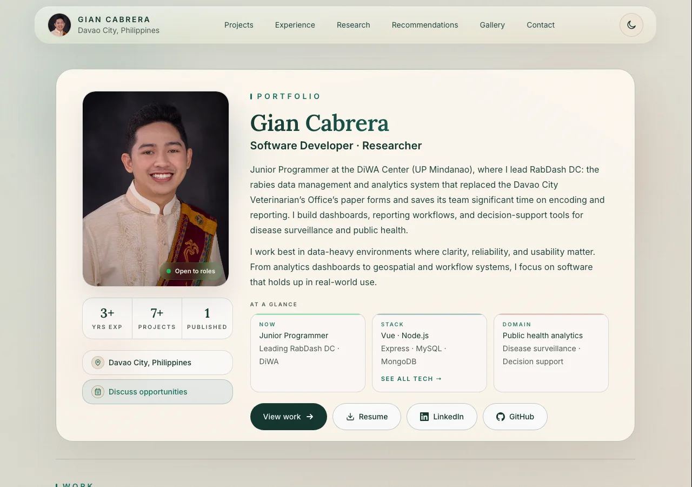

# Gian Cabrera — Portfolio

Personal portfolio of **Gian Cabrera**, a software developer and researcher at the Mindanao Center for Disease Watch and Analytics (DiWA Center), UP Mindanao. I build public health dashboards, disease surveillance tools, and decision-support systems.

**Live site:** https://gian-portfolio-theta.vercel.app/



## What's inside

- **Projects:** RabDash DC, DiWA Disease Trends Dashboard, the IWOMB 2025 website, and more
- **Experience & capabilities:** roles at the DiWA Center and UP Mindanao
- **Research & talks:** paper presentations and project pitches
- **Recommendations:** notes from colleagues and classmates
- **Gallery:** conferences, demos, and milestones, with a thumbnail strip to jump between events
- **Contact:** email, Calendly, resume, LinkedIn, and GitHub

Also included: light and dark mode, reduced-motion support, and social link previews (Open Graph).

## Tech stack

- [Vue 3](https://vuejs.org/) (`<script setup>` single-file components)
- [Vite](https://vite.dev/)
- [Tailwind CSS 4](https://tailwindcss.com/)
- Hosted on [Vercel](https://vercel.com/), with Vercel Web Analytics

## Run locally

Requires Node.js 20 or newer.

```bash
npm install
npm run dev       # start the dev server at http://localhost:5173
npm run build     # production build into dist/
npm run preview   # serve the production build locally
```

## Project structure

```
src/
  data/portfolio.js       # all site content: profile, projects, case studies, experience, research, gallery, recommendations
  components/sections/    # one component per page section
  components/SiteHeader.vue
  pages/CaseStudyPage.vue # layout for case study pages
  case-study.js           # entry point for case study pages
  composables/            # active-section tracking and scroll reveal
  style.css               # theme tokens (light/dark) and global styles
rabdash-dc-mobile/        # case study page (/rabdash-dc-mobile/), a separate Vite entry
public/                   # images (WebP), resume PDF, link preview image, robots.txt, sitemap.xml
docs/                     # README assets (not deployed)
```

## Updating content

Almost everything on the site is driven by [`src/data/portfolio.js`](src/data/portfolio.js), so most updates don't need component changes.

**Add a gallery event:** add an entry at the top of `gallery.events` (events are listed newest first):

```js
{
  title: 'Event name 2026',
  shortTitle: 'Event 2026',                 // optional: label under the thumbnail
  meta: 'Venue · Oct 1, 2026 · Your role',
  cover: '/gallery-thumbs/Event_1.webp',    // optional: 320px thumbnail
  photos: [
    { title: 'DEMO', meta: 'Event name 2026', src: '/Event_1.webp', alt: 'Describe the photo' },
  ],
}
```

Convert photos to WebP before adding them to `public/` (requires `cwebp`, e.g. `brew install webp`):

```bash
cwebp -q 80 -resize 1600 0 Event_1.jpeg -o public/Event_1.webp                  # landscape; use -resize 0 1600 for portrait
cwebp -q 78 -resize 320 0 public/Event_1.webp -o public/gallery-thumbs/Event_1.webp
```

**Add a case study page:** add its content to `caseStudies` in `portfolio.js`, copy `rabdash-dc-mobile/index.html` to a new folder named after the slug (update the title, meta tags, and `data-case-study`), add it to `build.rollupOptions.input` in `vite.config.js`, and set the project's `caseStudyUrl` to `/<slug>/`.

**Add a talk or paper:** add an entry to `research.items`. Set `url` once a paper is published, and remove `status`.

## License

© Gian R. Cabrera. All rights reserved. The code is public for reference; please don't reuse the content, photos, or personal details.
